# Lab 01 – Machine Learning

## Objective

This section documents the practical activities completed during Laboratory 01, focusing on designing, training, and evaluating a **Bidirectional Long Short-Term Memory (Bi-LSTM)** neural network for binary sentiment classification of text reviews.

---

## Tasks and Implementation

1. **Dataset Loading & Merging:** Combined three tab-separated sentiment datasets (`amazon_cells_labelled.txt`, `imdb_labelled.txt`, and `yelp_labelled.txt`) into a unified dataset of **2,748 reviews** (`1,386` positive and `1,362` negative).
2. **Text Preprocessing & Exploratory Data Analysis:** Normalized text by converting to lowercase, stripping punctuation and special characters via regex, and removing extra whitespace. Inspected class balances and top word frequencies across positive and negative reviews.
3. **Train-Test Split & Tokenization:** Split the dataset into **80% training (2,198 samples)** and **20% testing (550 samples)** using stratified sampling. Fitted a Keras `Tokenizer` (`num_words=10000`, `oov_token="<OOV>"`, resulting in a vocabulary size of **4,712**) and applied post-padding (`maxlen=100`).
4. **Neural Network Architecture:** Built a TensorFlow/Keras `Sequential` model with **706,113 trainable parameters**:
   - `Input(shape=(100,))`
   - `Embedding(input_dim=4712, output_dim=128, mask_zero=True)`
   - `Bidirectional(LSTM(64))`
   - `Dropout(0.3)`
   - `Dense(32, activation='relu')`
   - `Dropout(0.3)`
   - `Dense(1, activation='sigmoid')`
5. **Training & Regularization:** Compiled with the `adam` optimizer and `binary_crossentropy` loss, and trained with a `20%` validation split (`batch_size=32`) using `EarlyStopping(monitor='val_loss', patience=3, restore_best_weights=True)`.

### Folder Structure
- `notebooks/Sentiment-Analysis-Model-Using-NN.ipynb` – Complete implementation notebook.
- `screenshots/` – Execution evidence and performance plots.

---

## Results and Evidence

### Evaluation Metrics (Test Set – 550 Samples)

| Metric | Score |
| :--- | :--- |
| **Test Accuracy** | `80.55%` (`0.8055`) |
| **Test Loss** | `0.4512` |
| **Precision** | `0.7993` |
| **Recall** | `0.8195` |
| **F1 Score** | `0.8093` |

### 01. Dataset Loading
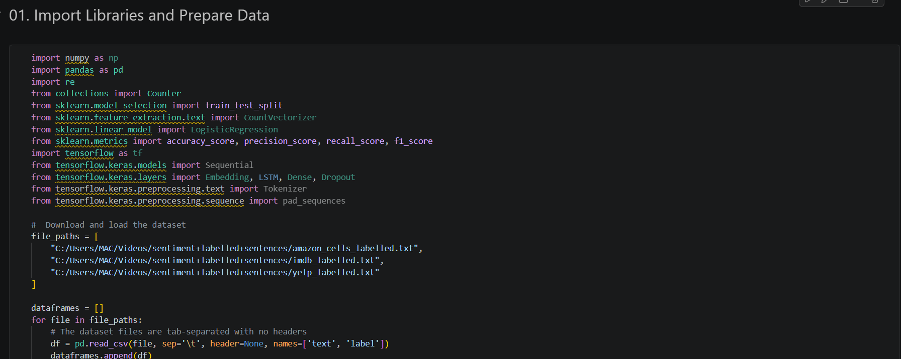

### 02. Exploratory Data Analysis
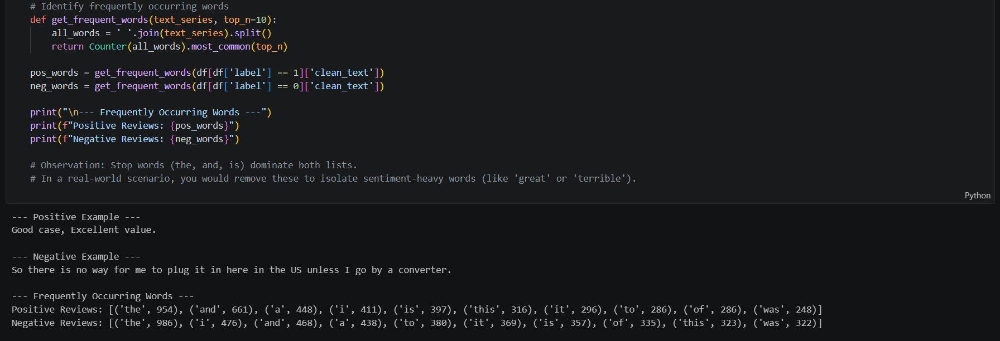
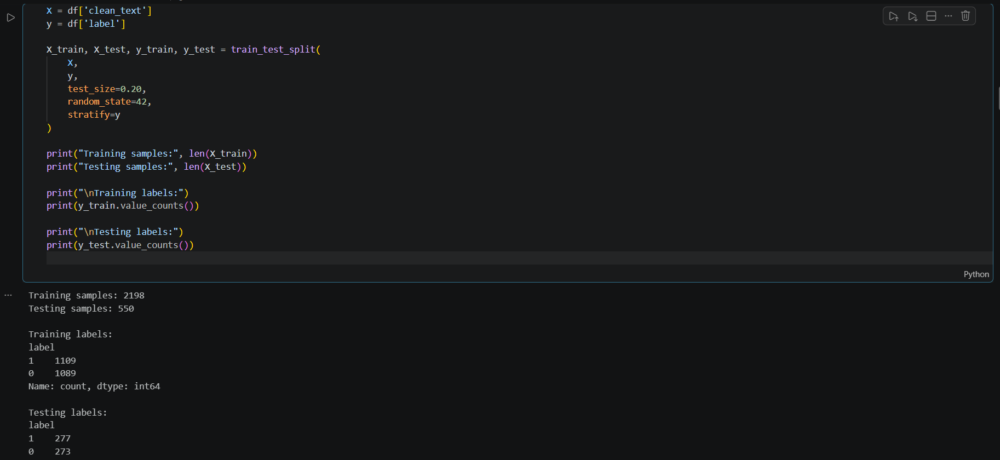

### 03. Data Preprocessing & Tokenization
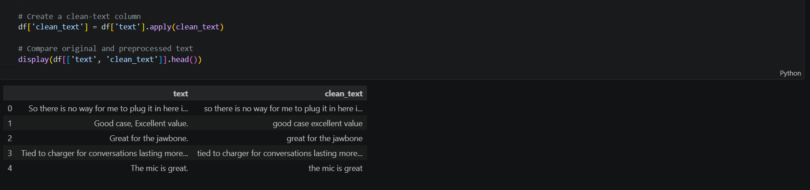
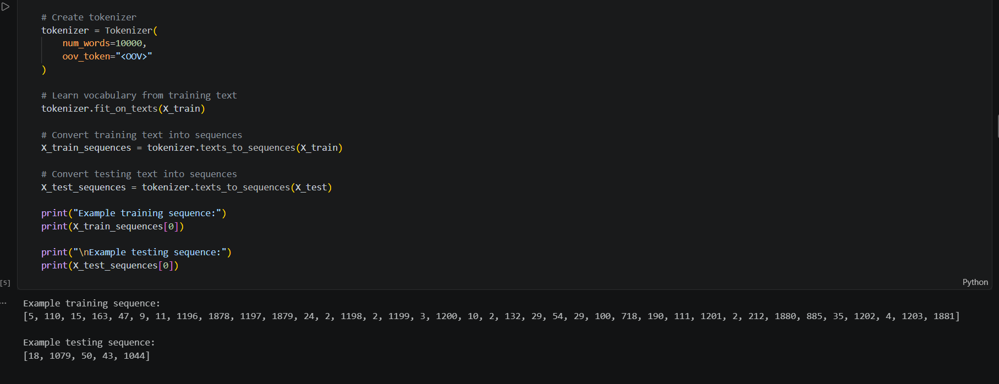

### 04. Neural Network Architecture
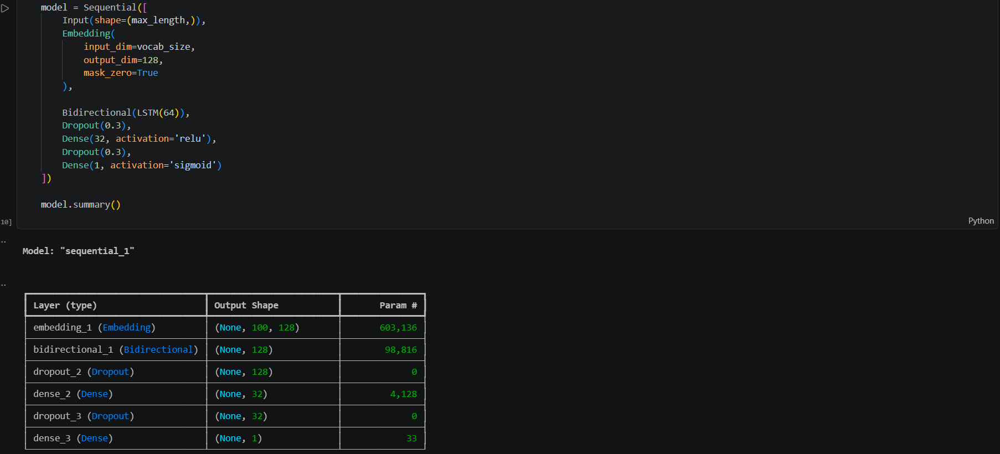
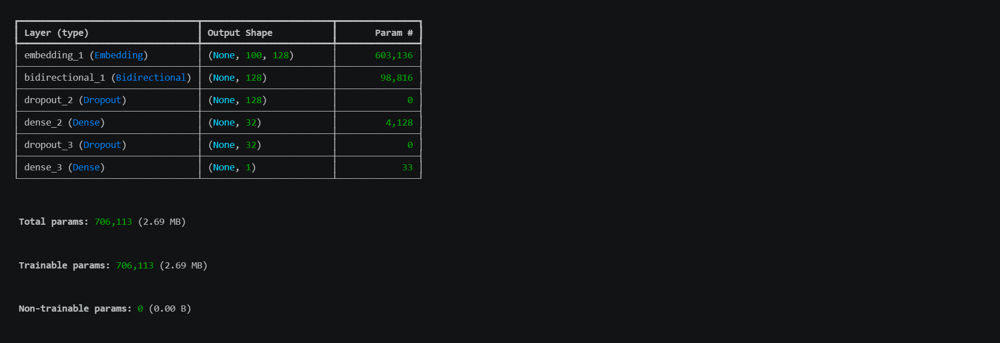

### 05. Model Training
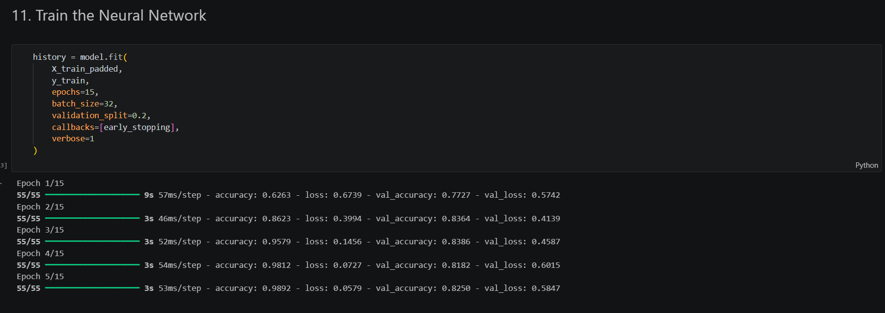

### 06. Model Evaluation
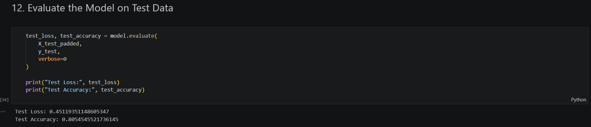
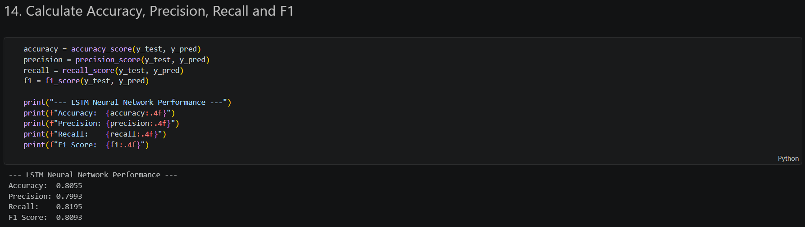
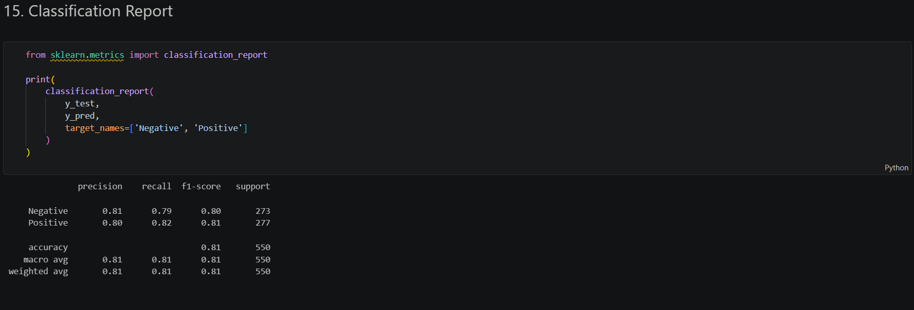

### 07. Visualisations (Confusion Matrix & Loss Curve)
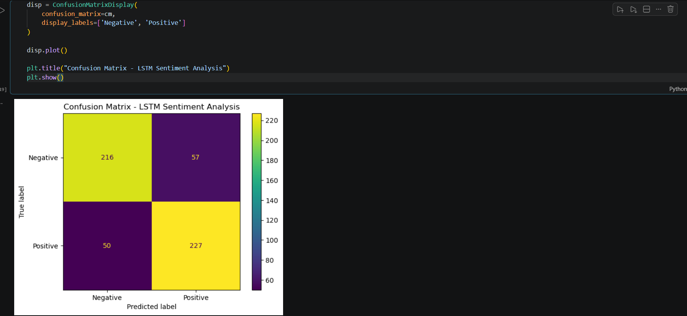

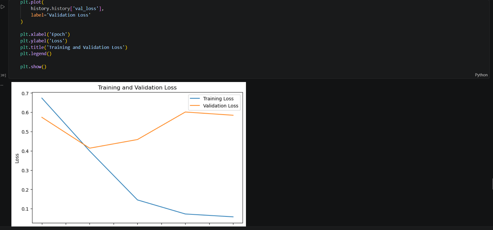

### 08. Sample Predictions
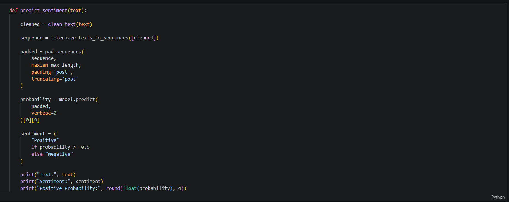
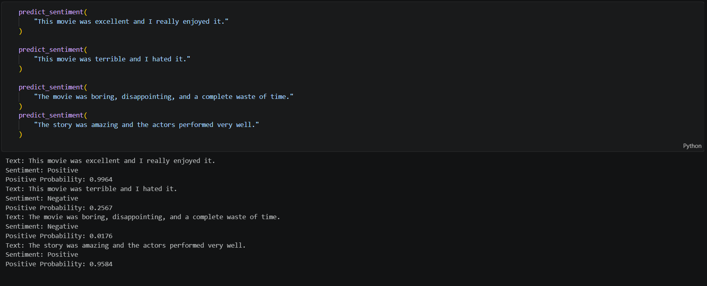

---

## Observations

- **Overfitting & Early Stopping:** Training accuracy increased rapidly from `62.63%` in Epoch 1 to `98.92%` by Epoch 5, while validation loss reached its minimum (`0.4139`, `83.64%` val accuracy) at **Epoch 2** before rising. `EarlyStopping` effectively halted training at Epoch 5 and restored the optimal Epoch 2 weights.
- **Balanced Classification:** The model achieved balanced performance across both classes on unseen test data (`0.80` F1-score for Negative reviews and `0.81` F1-score for Positive reviews), with slightly higher recall (`0.82`) on positive reviews.
- **Stop-Word Dominance:** Exploratory frequency counts showed that common stop words (`the`, `and`, `is`, `to`) dominated both positive and negative reviews, highlighting the importance of sequence context captured by the Bi-LSTM layer.

---

## Learning Outcomes

- Gained hands-on experience preparing raw unstructured text for deep learning through regex cleaning, tokenization, out-of-vocabulary handling (`<OOV>`), and fixed-length sequence padding.
- Learned how `Embedding` layers combined with `Bidirectional LSTM` networks capture sequential word dependencies in both forward and backward contexts.
- Applied regularization techniques (`Dropout` layers and `EarlyStopping` callbacks) to prevent overfitting on relatively small text datasets (`2,748` samples).
- Evaluated binary classifier performance beyond raw accuracy using precision, recall, F1-score, confusion matrices, and training/validation loss curves[cite: 5].
