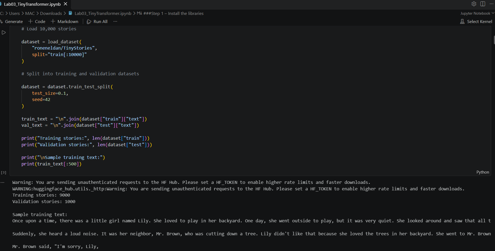
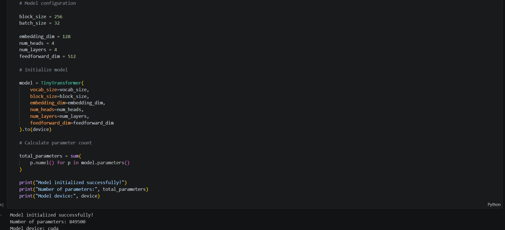
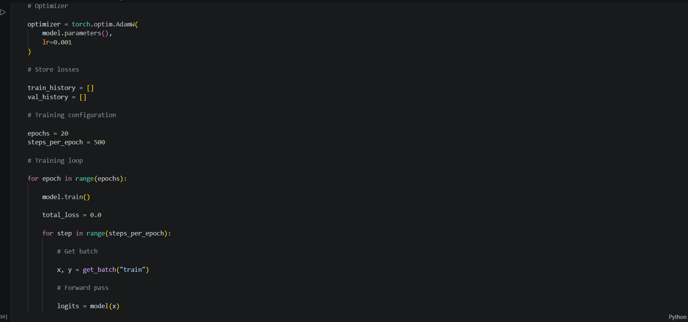
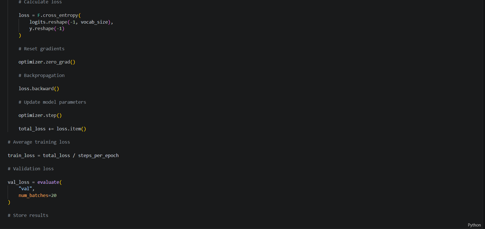
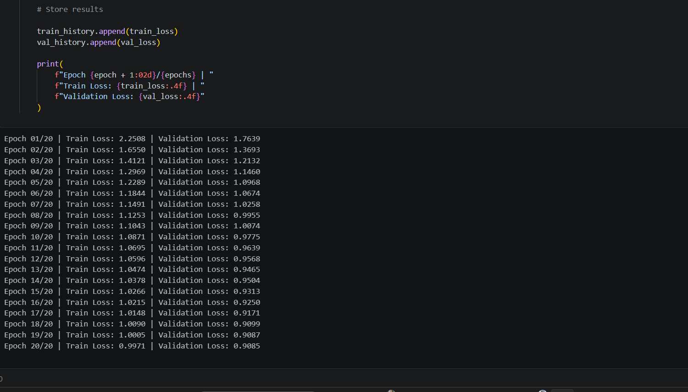
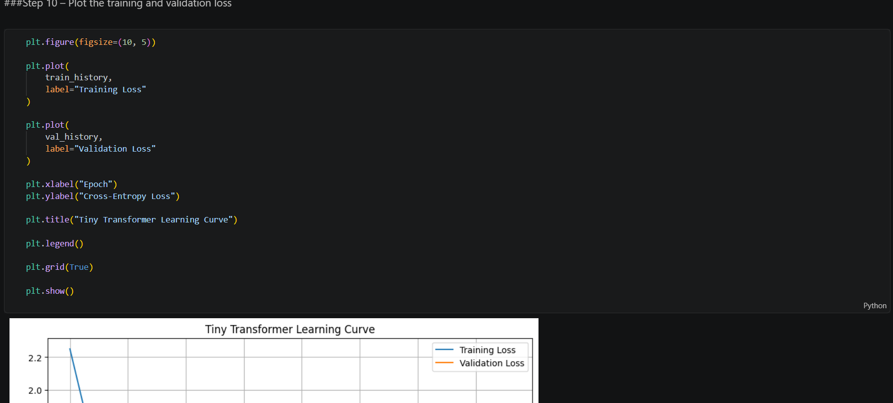
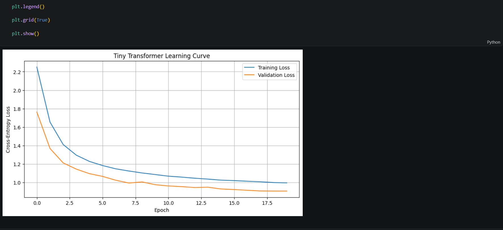
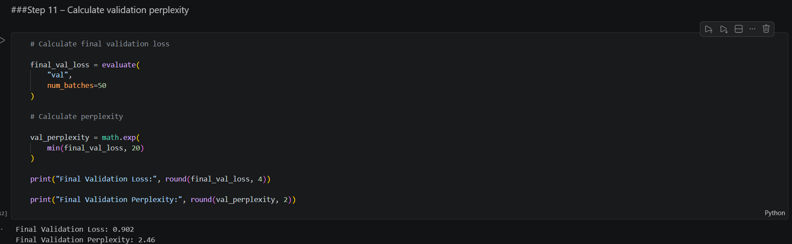
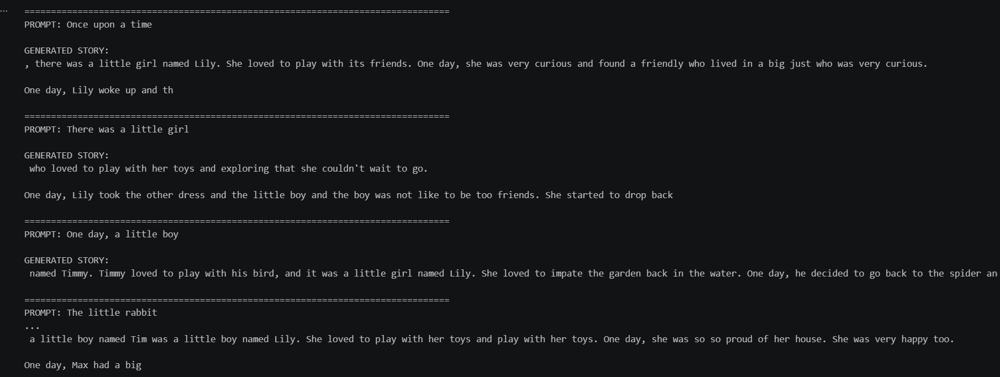
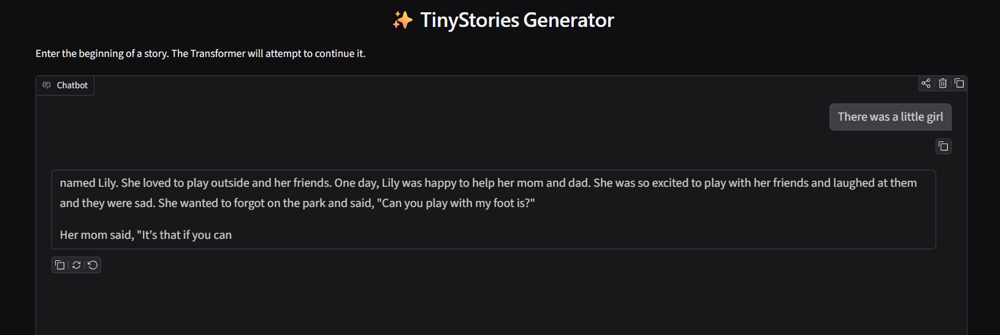

# Lab 03 – Tiny Transformer Language Model

## Objective

The objective of this practical is to implement, train, evaluate, and experiment with a small character-level Transformer language model using PyTorch and the TinyStories dataset.

This practical explores the fundamentals of language modelling, character-level tokenization, Transformer architecture, next-character prediction, model training, evaluation, and text generation.

## Tasks and Implementation

### 1. Dataset Loading

The TinyStories dataset was loaded using the Hugging Face Datasets library. A subset of the dataset was used for the experiment and divided into training and validation sets.

### 2. Character-Level Tokenization

A character-level tokenizer was implemented by assigning a unique numerical ID to each character in the dataset. Encoding and decoding functions were developed to convert text into numerical sequences and reconstruct text from numerical IDs.

### 3. Transformer Architecture

A small Transformer language model was implemented using PyTorch. The model consists of:

- Token embeddings
- Positional embeddings
- Transformer encoder layers
- Causal attention masking
- Feed-forward layers
- Language modelling output layer

### 4. Training

The model was trained to predict the next character in a sequence using the TinyStories dataset.

The AdamW optimizer and cross-entropy loss function were used during training. Training and validation losses were recorded to monitor the model's learning performance.

### 5. Model Evaluation

The model was evaluated using validation loss and perplexity. Training and validation loss curves were visualized to observe the learning behaviour of the model.

### 6. Text Generation

A text generation function was implemented to generate text based on a user-provided prompt. Temperature-controlled sampling was used to control the randomness of generated text.

### 7. Interactive Interface

A Gradio interface was developed to allow users to enter story prompts and interact with the trained language model through a simple web interface.

## Results and Evidence

### Dataset Loading

The TinyStories dataset was loaded and divided into training and validation sets.



### Transformer Architecture

The Transformer architecture was implemented and initialized using PyTorch.



### Training Results

The model was trained using the training dataset, and training and validation losses were recorded.






### Training and Validation Loss

The training and validation loss curves were plotted to visualize the model's learning performance.




### Perplexity Evaluation

Validation perplexity was calculated to evaluate the model's next-character prediction performance.



### Text Generation

The trained Transformer was tested using different text prompts to observe its text-generation behaviour.



### Gradio Interface

An interactive Gradio interface was developed to test the text-generation functionality.



## Observations

- The Transformer was trained to predict the next character based on previously observed characters.
- Character-level tokenization allowed the model to learn text patterns without using word-level tokenization.
- Training and validation losses provided insight into the model's learning behaviour.
- Text generation demonstrated the model's ability to continue text based on an input prompt.
- The quality of generated text depended on the training process, dataset size, model configuration, and sampling settings.
- The model occasionally generated repetitive, grammatically incorrect, or incoherent text, demonstrating the limitations of a small language model trained from scratch.

## Learning Outcomes

- Gained practical experience implementing a Transformer language model using PyTorch.
- Understood character-level tokenization and numerical text representation.
- Explored token embeddings and positional embeddings.
- Implemented causal masking to prevent the model from accessing future characters.
- Learned the fundamentals of next-character prediction.
- Practiced training and evaluating a language model.
- Used cross-entropy loss and perplexity to evaluate model performance.
- Visualized training and validation loss.
- Experimented with text generation and temperature-controlled sampling.
- Developed an interactive text-generation interface using Gradio.

## Technologies Used

- Python
- PyTorch
- Hugging Face Datasets
- Matplotlib
- Gradio

## Notebook

The complete implementation is available in the [`notebooks`](notebooks/) folder.

## Repository Structure

```text
Lab-03-Tiny-Transformer/
│
├── notebooks/
│   └── Lab03_TinyTransformer.ipynb
│
├── screenshots/
│   ├── 01_dataset_loading.png
│   ├── 02_model_architecture.png
│   ├── 03_training_results.png
│   ├── 04_loss_graph.png
│   ├── 05_perplexity.png
│   ├── 06_generated_text.png
│   └── 07_gradio_interface.png
│
└── README.md
```
