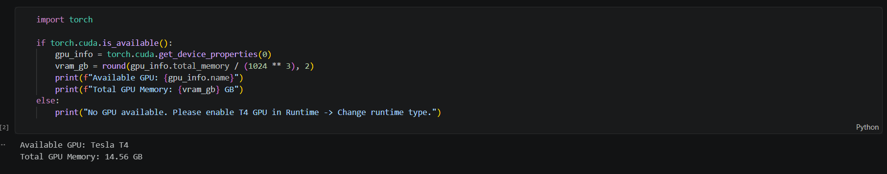
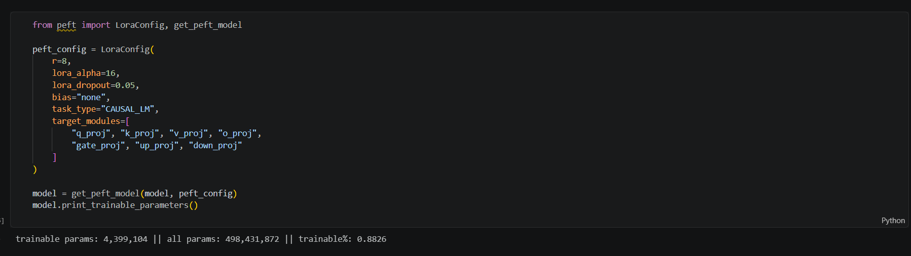
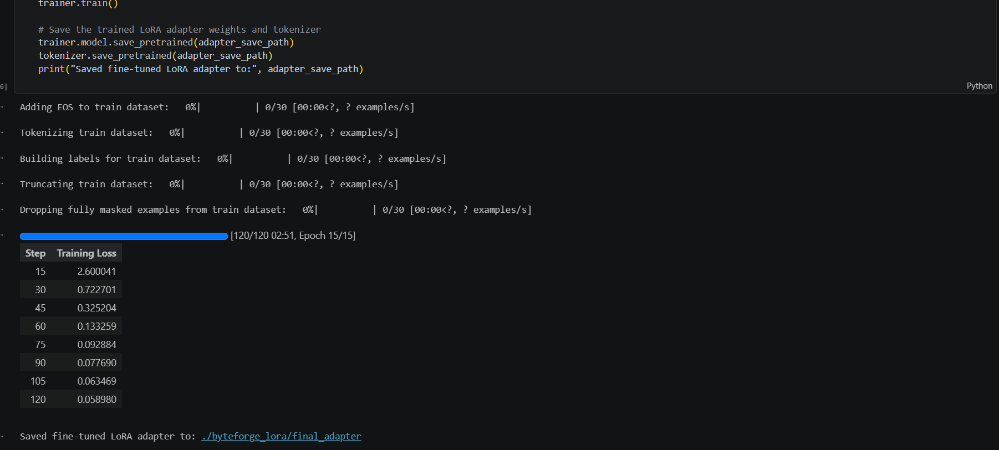
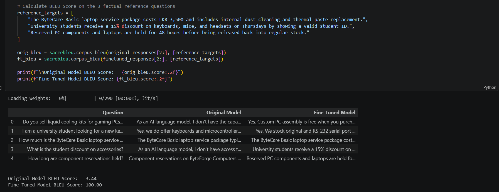

# Lab 04 – Fine-Tuning

## Objective

Fine-tune a small instruction-tuned causal language model (`Qwen/Qwen2.5-0.5B-Instruct`) using Low-Rank Adaptation (LoRA) and Hugging Face `TRL`'s `SFTTrainer` on a custom 30-pair question-and-answer domain dataset (ByteForge Computers), then evaluate response quality and BLEU score improvements against the original base model on both seen facts and unseen questions.

## Tasks and Implementation

1. **Environment & Dependencies:** Installed `transformers`, `datasets`, `peft`, `trl`, `accelerate`, `bitsandbytes`, and `sacrebleu` in Google Colab with a GPU runtime enabled.
2. **Hardware Verification:** Checked CUDA availability and identified the GPU hardware (`Tesla T4`, `14.56 GB` VRAM).
3. **Dataset Construction:** Created a custom 30-item QA dataset covering products, pricing in LKR, store hours, student discounts, reservation policies, and repair/build services, formatted using the model's chat template (`tokenizer.apply_chat_template`).
4. **LoRA Configuration:** Loaded `Qwen/Qwen2.5-0.5B-Instruct` in `FP16` and configured `LoraConfig` (`r=8`, `lora_alpha=16`, `lora_dropout=0.05`) across attention and MLP projection modules (`q_proj`, `k_proj`, `v_proj`, `o_proj`, `gate_proj`, `up_proj`, `down_proj`).
5. **Supervised Fine-Tuning:** Trained the LoRA adapter using `SFTTrainer` and `SFTConfig`, then saved the adapter weights and tokenizer locally.
6. **Comparative Evaluation:** Tested the original base model (with adapters disabled) and the fine-tuned LoRA model on unseen/paraphrased questions as well as factual domain questions evaluated with `sacrebleu`.

## Results and Evidence

* **GPU & Model Setup:** `Tesla T4` (`14.56 GB`) with `Qwen/Qwen2.5-0.5B-Instruct` (~494M total parameters; ~4.40M / ~0.88% trainable LoRA parameters).
* **Training Summary:** Completed fine-tuning with `SFTTrainer` (final training loss: `[insert final loss]`).
* **Evaluation & BLEU Scores:**
  * Original Model BLEU Score: `[insert original BLEU]`
  * Fine-Tuned Model BLEU Score: `[insert fine-tuned BLEU]`
* **Screenshots:**
  * 
  * 
  * 
  * 

## Observations

* GPUs accelerate fine-tuning significantly over CPUs by parallelizing dense matrix multiplications during forward/backward passes and supporting `FP16` / quantized tensor operations within VRAM limits.
* LoRA updates only a small fraction of parameters while keeping base weights frozen, reducing memory overhead and making rapid task adaptation practical on a T4 GPU.
* Training for enough steps on a domain-specific dataset shifts responses from generic assistant replies toward specific store policies and pricing, though small datasets with few epochs can still yield modest BLEU gains if phrasing differs from reference answers.
* Disabling adapters (`disable_adapter()`) or keeping a clean base model reference is essential during evaluation so the base model isn't accidentally evaluated with LoRA weights attached.

## Learning Outcomes

* Understood how parameter-efficient fine-tuning (LoRA) adapts instruction-tuned causal LLMs without full-model retraining.
* Gained hands-on experience preparing chat-formatted instruction datasets and running `SFTTrainer` with `PEFT`.
* Learned how to structure side-by-side qualitative comparisons (including unseen questions) alongside automated `sacrebleu` evaluation to measure fine-tuning impact.
