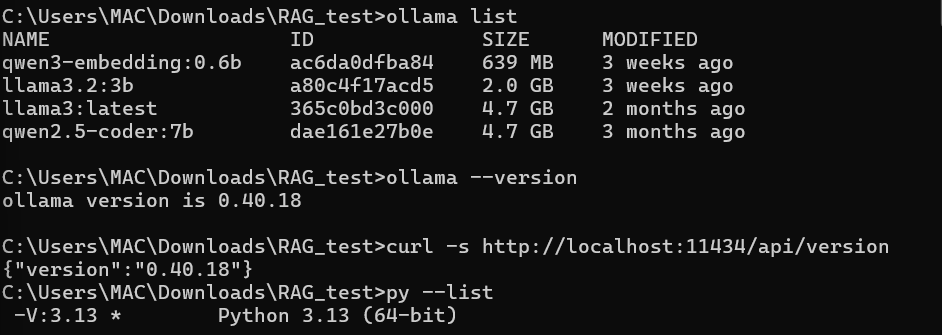
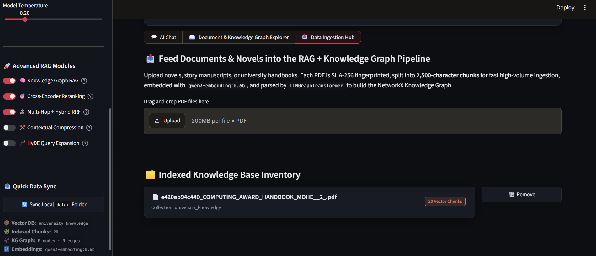
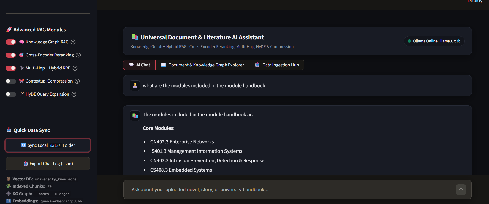

# Lab 05 – Retrieval-Augmented Generation (RAG)

## Objective

Design, implement, and evaluate a local Retrieval-Augmented Generation (RAG) and memory-augmented AI pipeline using **Ollama**, **LangChain**, **ChromaDB**, and **SQLite** to answer domain-specific academic queries grounded in ingested PDF documents (such as university program handbooks) rather than relying solely on parametric model memory.

## Tasks and Implementation

1. **Local Model & Environment Setup:**
   - Configured a Python 3.13 virtual environment (`rag_env`) with `langchain-ollama`, `langchain-chroma`, `streamlit`, `networkx`, and `pymupdf`.
   - Deployed `qwen3-embedding:0.6b` for dense vector embeddings and `llama3.2:3b` for grounded response generation and tool calling via Ollama.
2. **Document Ingestion & Vector Indexing (`notebooks/ingest.py`):**
   - Loaded source PDF documents from the local `data/` folder, split the text into overlapping chunks, generated embeddings using `qwen3-embedding:0.6b`, and persisted vectors in a local ChromaDB collection (`university_knowledge`).
3. **RAG Retrieval & Interactive Explorer (`notebooks/rag_pipeline.py`, `notebooks/app.py`):**
   - Built a semantic similarity retrieval pipeline (`top-k` search) and an interactive Streamlit dashboard featuring **AI Chat**, **Document & Knowledge Graph Explorer**, and **Data Ingestion Hub** views, with optional reranking and multi-hop retrieval toggles.
4. **SQLite Long-Term Memory & Agent Integration (`notebooks/mem_rag_agent.py`):**
   - Integrated ChromaDB knowledge retrieval with persistent SQLite user memory (`save_student_memory` / `search_student_memory`) and desktop automation tools behind deterministic intent guardrails.
5. **Repository Organization (`.gitignore`):**
   - Placed source scripts under `notebooks/`, visual proof under `screenshots/`, and excluded heavy local runtime artifacts (`rag_env/`, `chroma_db/`, `student_memory.db`, `__pycache__/`) via `.gitignore`.

## Results and Evidence

- **Document Indexing & Retrieval:** Successfully ingested reference PDF documents into ChromaDB (`university_knowledge`) using `qwen3-embedding:0.6b` and retrieved relevant context chunks for academic module and handbook queries.
- **Grounded Generation & Memory Execution:** Verified that `llama3.2:3b` produces grounded answers strictly from retrieved chunks and accurately stores/recalls user facts in SQLite during agent sessions.

### Screenshots

#### 1. Environment & Ollama Model Setup

#### 2. Document Ingestion & Chunk Indexing

#### 3. RAG Retrieval & Grounded Answer

#### 4. Document & Advanced RAG Explorer

#### 5. Memory & Agent Tool Execution

## Observations

- **Grounding Reduces Hallucination:** Pairing dense vector retrieval (`qwen3-embedding:0.6b`) with strict context-only prompt instructions prevents `llama3.2:3b` from fabricating module codes or handbook rules absent from the PDF.
- **Local Resource Management:** Running local embedding and generation models sequentially on CPU/integrated graphics requires closing memory-heavy background applications so the Ollama model runner retains sufficient available RAM.
- **Tool Routing Guardrails:** Compact 3B models require clear intent routing rules and sanitized short-term history windows to prevent repetitive tool-call loops.

## Learning Outcomes

- Built an end-to-end offline RAG pipeline covering PDF parsing, text chunking, vector embedding storage in ChromaDB, and grounded LLM generation.
- Combined vector knowledge retrieval with persistent SQLite memory and structured tool calling inside a unified agent workflow.
- Applied clean Git repository hygiene using `.gitignore` to keep local environments and vector databases separate from reproducible source code and documentation.
